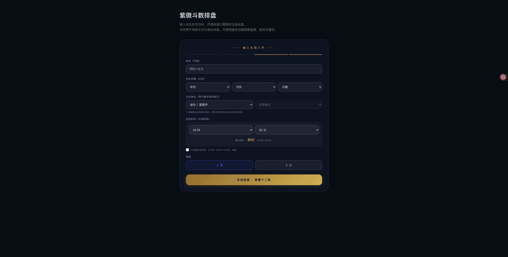
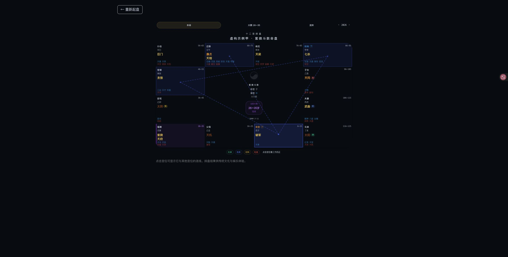

# 启动与使用

## 安装和启动

把压缩包完整解压到自己的文件夹，例如“文稿/紫微排盘”。双击“启动.command”，脚本先核对随包精简运行环境的 SHA256（原始官方归档来源另见SOURCE），再解压到 `.runtime/`，随后在本机 4819 端口启动。依赖已随包提供，启动时无需联网安装。

成功标志：终端显示“已启动：http://127.0.0.1:4819/”，浏览器出现“紫微斗数排盘”。浏览器未自动打开时，手动打开上述地址。

## 体验一张可交互盘面

可先试原创虚构样例：姓名“虚构示例甲”、公历2000年4月15日、08时00分、男，地点留空。点击“生成排盘 · 查看十二宫”，可见完整十二宫，中央显示命宫子、身宫申、火六局。

点“命宫”，相关宫位会高亮并出现虚线；再次点选或改点其他宫位可继续观察。盘面上方可以切换本命、大限与流年视图。

“重新起盘”会回到空白输入表单。姓名与地点均为选填；地点会参与真太阳时校正。文中虚构日期供文化与娱乐体验，结果不作为现实决策依据。

## 停止、重启与端口

双击“停止.command”结束本文件夹启动的服务；双击“重启.command”先停止，再启动。

默认端口4819。如被其他程序占用，脚本会提示并退出。可在本文件夹的终端执行 `REPOGO_PORT=4829 bash 启动.command`，然后打开 http://127.0.0.1:4829/。停止脚本使用启动时保存的进程记录。服务只监听127.0.0.1。

## 数据、移动与源码

运行记录放在 `.run/`，自备环境放在 `.runtime/`。这份体验入口不保存排盘历史，重新起盘需重新输入。移动文件夹前先停止服务；备份时复制原始压缩包或完整项目文件夹。

`source/` 提供本次实际运行所对应的代码白名单、配置与依赖锁，供需要二次开发的读者使用；普通体验直接使用启动脚本即可。源码重新构建需要另行准备Node并获取锁定npm依赖，不是离线启动步骤的一部分。

## 系统边界

苹果芯片Mac：运行包及核心交互已本机实测。Windows、Linux、Intel Mac：未实测，未提供对应自备运行环境。上游是Next网页项目，此包对外说明以实际验收范围为准。

本轮实际验收通过终端bash调用启动、停止和重启脚本，并以独立浏览器验证；Finder双击启动尚未单独实测。
