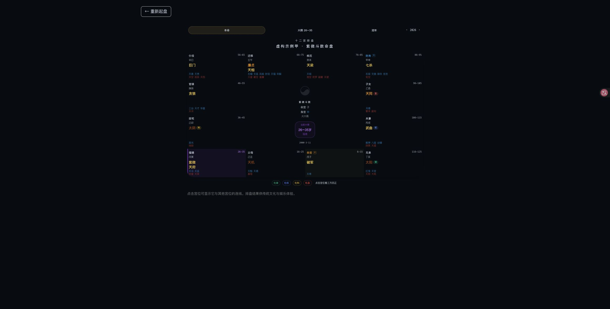

# 紫微排盘 · 本地文化体验

在自己的电脑上生成中文十二宫盘面，点击宫位即可看见关联宫位和连线。适合对紫微斗数排盘结构感兴趣的传统文化与娱乐体验。

图文使用说明：[打开页面、排盘与宫位联动](member/START_HERE.md)。

## 苹果芯片 Mac：从这里开始

1. 完整解压文件夹，双击 **启动.command**。脚本会自动准备随包附带的运行环境并打开中文页面，无需预装 Node、Python 或 uv。
2. 页面地址为 **http://127.0.0.1:4819/**。选择公历日期、时间与性别，姓名可留空，点击 **生成排盘 · 查看十二宫**。
3. 点一个宫位，观察高亮和虚线。结束时双击 **停止.command**；再次使用可双击 **重启.command**。

首次启动会在文件夹内解压自备环境。启动流程可离线完成，不需要模型账号或密钥。请把整个文件夹放在可写位置，勿只复制启动脚本。

若双击无法运行，可在终端进入本文件夹执行 `bash 启动.command`。遇到 macOS 的安全拦截，请按系统提供的正常审核流程处理，本文不修改系统安全策略。

详细使用与安装见 [DEPLOY.md](DEPLOY.md)，故障处理见 [FAQ.md](FAQ.md)，项目与许可证见 [SOURCE.md](SOURCE.md)。

实测范围：苹果芯片 Mac。Windows、Linux 和 Intel Mac 未实测，本运行包仅含 macOS ARM64 环境。

本轮已实际验收bash脚本调用与浏览器流程；Finder双击尚未单独实测。
